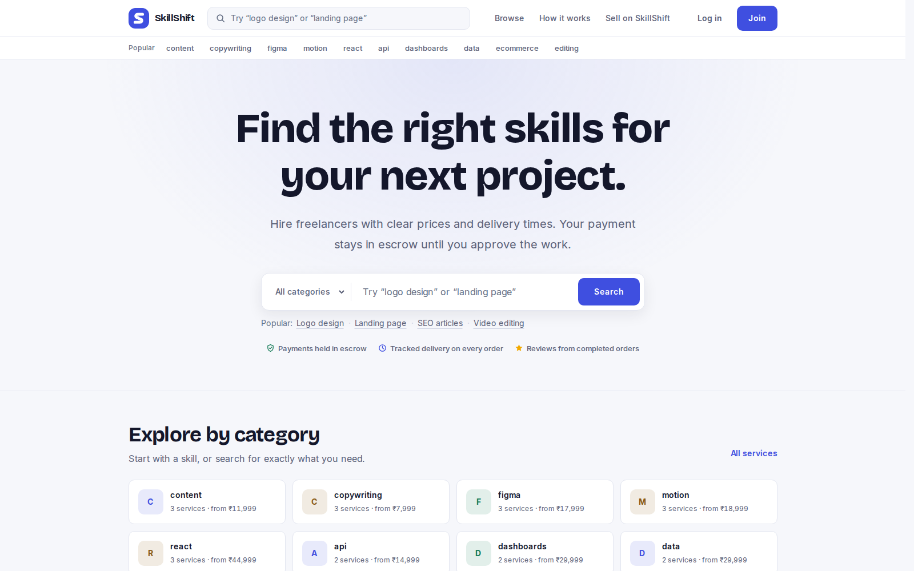
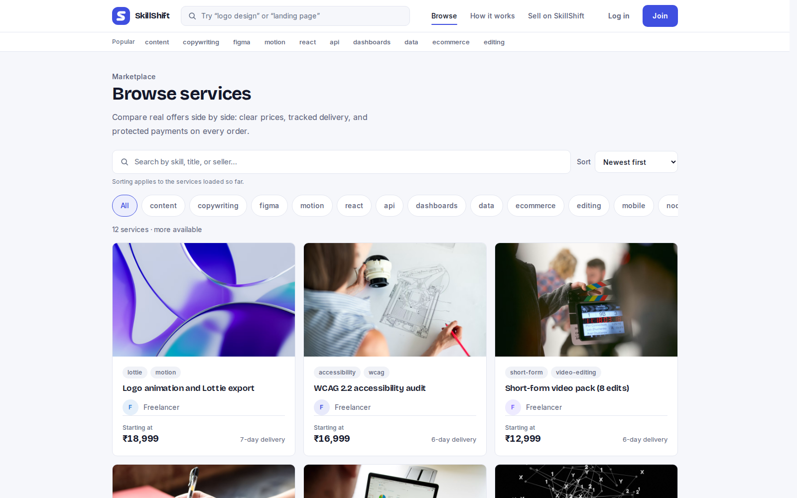
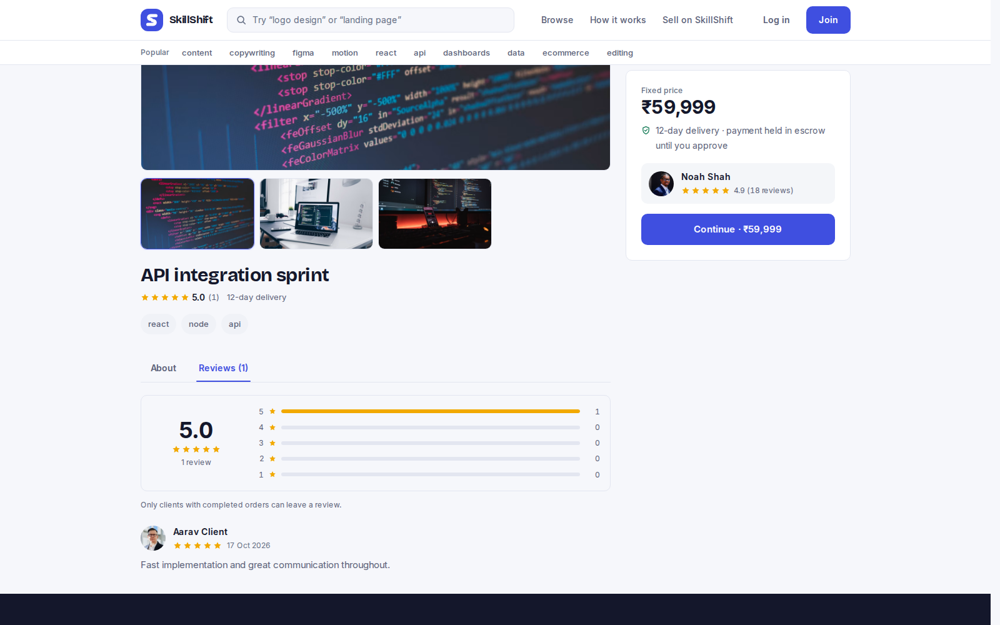
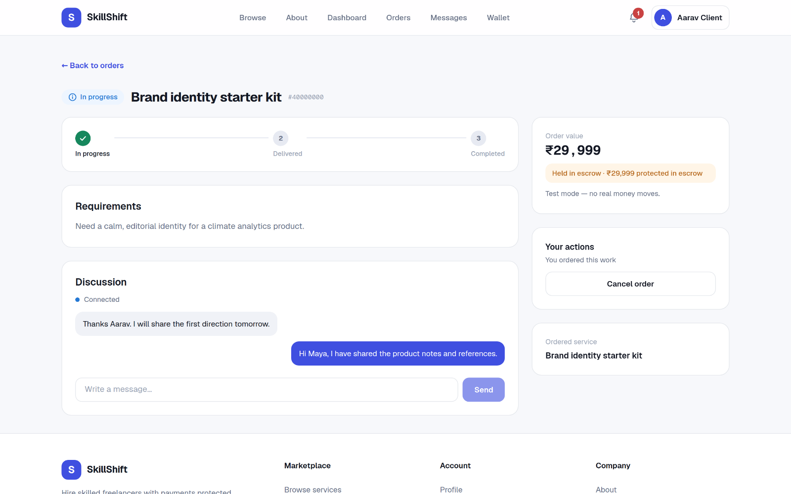
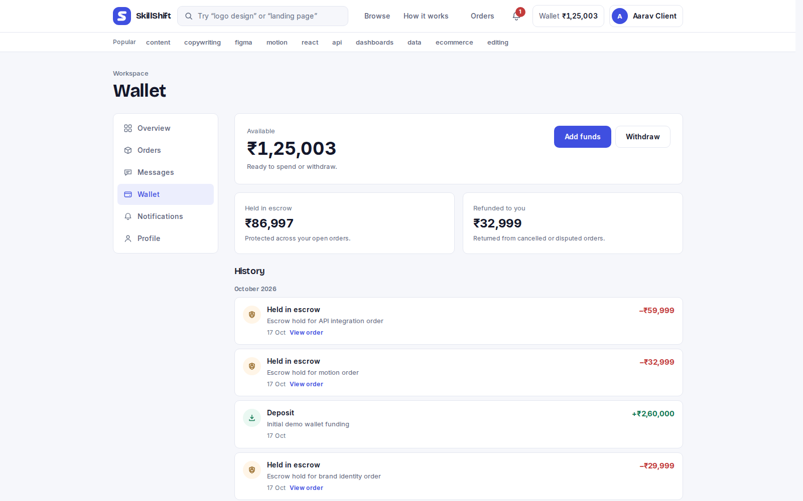
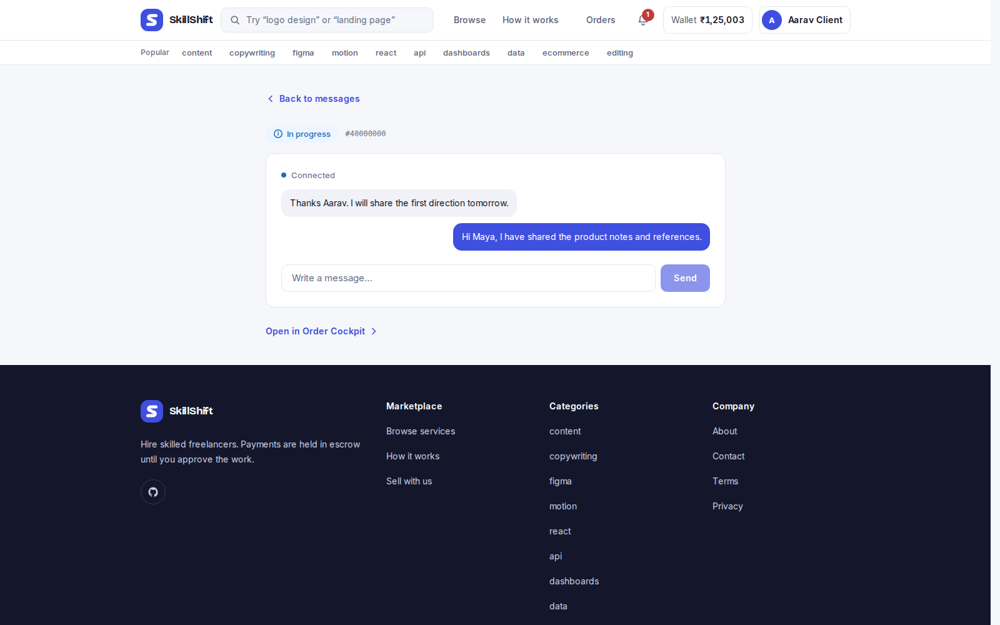

<p align="center">
  
</p>

<h1 align="center">SkillShift</h1>

<p align="center">
  <strong>The escrow-protected marketplace for freelance work.</strong><br>
  Hire skilled freelancers, collaborate in real time, and release payment only when the work is approved.
</p>

<p align="center">
  <a href="https://skillshift-live.vercel.app"></a>
  &nbsp;
  <a href="https://skillshift-api.duckdns.org/api/docs"></a>
  &nbsp;
  
  &nbsp;
  
</p>

<p align="center">
  
  &nbsp;
  
  &nbsp;
  
  &nbsp;
  
  &nbsp;
  
  &nbsp;
  
  &nbsp;
  
</p>

<p align="center">
  <a href="https://skillshift-live.vercel.app">Live demo</a> ·
  <a href="#screenshots">Screenshots</a> ·
  <a href="#features">Features</a> ·
  <a href="#engineering-highlights">Engineering</a> ·
  <a href="#architecture">Architecture</a> ·
  <a href="#getting-started">Getting started</a> ·
  <a href="#documentation">Documentation</a>
</p>

---

## What is SkillShift?

SkillShift is a two-sided marketplace for project-based work. Clients browse services offered by freelancers, order with the money held safely in escrow, collaborate with the freelancer through an order-scoped chat, and release payment only after approving the delivery. Freelancers publish services, deliver work, and build a reputation through reviews. Admins moderate the marketplace and resolve disputes — with a full audit trail behind every state change.

The whole product lives in this repo and runs live on the internet: a Next.js 16 web app, a NestJS 11 API, PostgreSQL with Prisma, Redis for caching and queues, WebSocket chat, and S3-backed uploads — deployed on Vercel and AWS, with the operational documentation to run it end to end.

**How an order works**

1. **Browse & order** — compare services by price, delivery window, and reviews, then place an order from your wallet.
2. **Money moves to escrow** — the order value is held by the platform, not the freelancer. Nobody can touch it while the work is in progress.
3. **Collaborate & deliver** — requirements, files, and updates stay in one order cockpit with real-time chat; the freelancer marks the work as delivered.
4. **Approve, cancel, or dispute** — approval releases escrow to the freelancer; cancellation refunds it; disputes go to admin resolution. Every transition is recorded.

## Screenshots

<p align="center">
  
</p>

|  |  |
| :---: | :---: |
|  |  |
|  |  |

<p align="center">
  
</p>

## Features

**For clients**

- **Discover** — full-text search and tags across the marketplace; compare price, turnaround, and reviews side by side.
- **Protected orders** — fund orders from an in-app wallet; the money is held in escrow, never sent to the freelancer directly.
- **One cockpit per order** — requirements, status timeline, delivery notes, files, chat, cancellation, and disputes in a single view.
- **Clear money states** — every balance labeled Available, Held in escrow, Released, or Refunded, with a full transaction history.

**For freelancers**

- **Publish services** — create and manage listings with photos, pricing, and delivery windows (S3-backed uploads).
- **Deliver with confidence** — submit work with notes and files; earnings are visible while in escrow and settle on release.
- **Grow reputation** — client reviews on completed orders, real-time messages, and notifications.

**For admins**

- **Operations dashboard** — platform analytics across users, orders, and GMV.
- **Dispute resolution** — investigate and resolve conflicts, with the outcome recorded on the order.
- **Moderation** — user and marketplace management on top of an append-only audit log.

**Money & trust**

- A complete wallet + escrow ledger: deposits, holds, releases, refunds, and withdrawals are all first-class transaction records.
- Payments are intentionally simulated — the UI is explicit that it's in test mode, so the demo is safe to click through end to end.
- Reviews are gated to completed orders, so social proof can't be gamed.

## Engineering highlights

- **Atomic money movement** — wallet debits, order creation, and escrow funding commit in a single Prisma `$transaction`; balances can't drift if a later step fails.
- **Guarded status transitions** — order and escrow lifecycles are validated in the service layer; invalid transitions are rejected server-side, not just hidden in the UI.
- **Session security** — short-lived JWT access tokens with rotating, hashed refresh tokens; a password reset invalidates every active session.
- **Redis cache-aside + BullMQ jobs** — hot marketplace queries are cached and invalidated on writes; delayed jobs auto-complete stale orders and queue transactional email.
- **Real-time chat** — a Socket.IO gateway with order-scoped rooms and Redis-backed online presence.
- **Presigned S3 uploads** — the API never proxies file bytes; the browser uploads directly with scoped, short-lived URLs.
- **Operational hygiene** — cursor-based pagination, append-only audit logs, three-role RBAC, and rate limiting on sensitive endpoints.

## Architecture

A modular NestJS monolith: PostgreSQL is the source of truth, Redis backs caching and the BullMQ queues, files live on S3, and WebSockets run inside the API process. The web app is a Next.js App Router frontend that talks to the API through a same-origin proxy.

```text
┌─────────────────────────────────────────────────┐
│              Next.js 16 · App Router            │
│       (Vercel · React 19 · Tailwind CSS 4)      │
└────────────────────────┬────────────────────────┘
                         │  HTTP / WebSocket
┌────────────────────────▼────────────────────────┐
│               NestJS 11 API Server              │
│                                                 │
│     Auth · User · Service · Order · Escrow      │
│     Wallet · Dispute · Chat · Notification      │
│     Search · Upload · Admin                     │
└────────┬─────────────────┬─────────────────┬────┘
         │                 │                 │
    ┌────▼─────┐      ┌────▼────┐      ┌─────▼─────┐
    │PostgreSQL│      │  Redis  │      │  AWS S3   │
    │  (data)  │      │cache +  │      │ (files)   │
    └──────────┘      │  queue  │      └───────────┘
                      └────┬────┘
                       ┌───▼───┐
                       │BullMQ │
                       └───────┘
```

**Key decisions**

- Modular monolith — clear module boundaries without microservice overhead at this scope.
- Business rules live in the service layer; controllers stay thin.
- Soft deletes on users and services; price snapshots on orders so later price edits never change existing orders.
- Refresh tokens stored as hashes — a database leak doesn't hand over live sessions.

## Tech stack

| Layer              | Technology                                             |
| ------------------ | ------------------------------------------------------ |
| Web app            | Next.js 16 (App Router) · React 19 · Tailwind CSS 4    |
| API                | NestJS 11 · TypeScript                                 |
| Database           | PostgreSQL · Prisma 7                                  |
| Cache & queues     | Redis · BullMQ                                         |
| Auth               | JWT access tokens + rotating refresh tokens (hashed)   |
| Real-time          | Socket.IO — order-scoped rooms, Redis presence         |
| File storage       | Amazon S3 (presigned uploads)                          |
| Email              | Nodemailer over SMTP (queued with BullMQ)              |
| Search             | PostgreSQL full-text search (`tsvector`)               |
| Infrastructure     | Docker Compose · Nginx · AWS EC2 · Vercel              |

## Repository layout

Two independent npm packages — there are no root scripts, so install and run commands from inside `backend/` or `frontend/`.

```text
skillshift/
├── backend/                        # NestJS API
│   ├── prisma/
│   │   ├── schema.prisma           # data model, enums, relations
│   │   ├── migrations/             # versioned SQL migrations
│   │   └── demo-seed.sql           # deterministic demo dataset
│   ├── src/
│   │   ├── auth/                   # registration, login, refresh, verification
│   │   ├── user/                   # accounts, profiles, reputation
│   │   ├── wallet/                 # balances, deposits, withdrawals, ledger
│   │   ├── service/                # service listings and moderation
│   │   ├── order/                  # order lifecycle and status transitions
│   │   ├── escrow/                 # holds, releases, refunds
│   │   ├── dispute/                # dispute resolution outcomes
│   │   ├── review/                 # ratings and profile aggregates
│   │   ├── search/                 # full-text service search
│   │   ├── chat/                   # Socket.IO gateway and message history
│   │   ├── notification/           # in-app notifications and queued email
│   │   ├── upload/                 # presigned S3 uploads
│   │   ├── admin/                  # moderation, analytics, dispute tools
│   │   ├── mail/                   # SMTP transport
│   │   ├── common/                 # guards, filters, interceptors, decorators
│   │   ├── prisma/                 # database module
│   │   └── redis/                  # cache, rate limits, presence, queues
│   ├── test/                       # end-to-end suites
│   ├── generated/                  # Prisma Client output (gitignored)
│   └── Dockerfile                  # production API image
├── frontend/                       # Next.js App Router web app
│   └── src/
│       ├── app/                    # routes, layouts, metadata, /api/backend proxy
│       ├── components/             # feature UI: marketplace, orders, wallet,
│       │                           # chat, dashboard, admin, profile, ui, layout
│       └── lib/                    # typed API client, session, socket, formatting
├── docs/                           # architecture · api-conventions · api-endpoints ·
│                                   # decisions · demo-data · deployment
├── .github/workflows/ci.yml        # lint, tests, build, publish, EC2 deploy
├── docker-compose.yml              # production stack: api, postgres, redis
└── docker-compose.dev.yml          # development override (loopback ports)
```

Prisma Client is generated into `backend/generated/` (gitignored) — run `npx prisma generate` after schema changes.

## Live demo

Both halves of the stack are deployed and open to explore:

- **Web app** → [skillshift-live.vercel.app](https://skillshift-live.vercel.app)
- **API docs** → [skillshift-api.duckdns.org/api/docs](https://skillshift-api.duckdns.org/api/docs) (Swagger UI)

Sign in with any of the seeded accounts:

| Role       | Email                      | Password   |
| ---------- | -------------------------- | ---------- |
| Client     | `client.one@skillshift.demo` | `Demo1234!` |
| Client     | `client.two@skillshift.demo` | `Demo1234!` |
| Client     | `priya@skillshift.demo`      | `Demo1234!` |
| Client     | `daniel@skillshift.demo`     | `Demo1234!` |
| Freelancer | `maya@skillshift.demo`       | `Demo1234!` |
| Freelancer | `noah@skillshift.demo`       | `Demo1234!` |

See [`docs/demo-data.md`](docs/demo-data.md) for the full account list and dataset details. The demo is seeded with 27 live services across 33 listings (4 awaiting moderation), plus funded wallets, active orders, and reviews. Payments run in test mode — no real money moves. These are shared accounts on a public deployment: don't enter personal or sensitive data, and expect demo data to be reset.

## Getting started

**Prerequisites:** Node.js 22.12+ (24 LTS recommended) and Docker.

```bash
git clone https://github.com/adityasah15/skillshift.git
cd skillshift
cp .env.example .env
```

`.env.example` documents every variable the backend reads (database, Redis, JWT secrets, SMTP, S3).

**1. Start infrastructure**

```bash
docker compose -f docker-compose.yml -f docker-compose.dev.yml up -d postgres redis
```

**2. Run the API** — `http://localhost:3000`, Swagger at `/api/docs`

```bash
cd backend
npm install
npx prisma migrate dev
npx prisma generate
npm run start:dev
```

**3. Run the web app** — `http://localhost:3001`

```bash
cd frontend
npm install
```

Create `frontend/.env.local`:

```bash
SKILLSHIFT_API_URL=http://localhost:3000
NEXT_PUBLIC_API_URL=http://localhost:3000
```

```bash
npm run dev -- -p 3001
```

Port 3001 matches the backend's CORS and WebSocket origin config (`FRONTEND_URL`).

**Optional: load the demo data**

```bash
docker compose exec -T postgres psql -U postgres -d skillshift < backend/prisma/demo-seed.sql
```

Seeds the demo accounts, the full service catalog, orders, wallets, and reviews. See [`docs/demo-data.md`](docs/demo-data.md) for details, including clearing the Redis cache after reseeding.

## Testing

```bash
cd backend
npm run test       # 36 suites · 221 tests (unit + integration)
npm run test:e2e   # 2 suites · end-to-end API flows (needs Postgres + Redis)
```

**225 tests across 38 suites, all passing.** Frontend checks:

```bash
cd frontend
npm run lint && npx tsc --noEmit && npm run build
```

## Deployment

The API ships as a Docker image to AWS EC2 behind Nginx with TLS; PostgreSQL and Redis run via Docker Compose on the same host. The web app deploys to Vercel. The deployment runbook — server layout, CI/CD, environment variables, and known gotchas — is in [`docs/deployment.md`](docs/deployment.md).

## Documentation

| Document                                         | Contents                                                |
| ------------------------------------------------ | ------------------------------------------------------- |
| [`architecture.md`](docs/architecture.md)        | System design, escrow flows, caching, realtime, and deployment |
| [`api-conventions.md`](docs/api-conventions.md)  | Response envelopes, auth, money, pagination, and rate limits |
| [`api-endpoints.md`](docs/api-endpoints.md)     | Full route inventory grouped by domain, with access levels |
| [`decisions.md`](docs/decisions.md)              | Engineering decision log                                |
| [`demo-data.md`](docs/demo-data.md)              | The seed dataset and how to reseed                      |
| [`deployment.md`](docs/deployment.md)            | Production deployment runbook                           |
| [Swagger UI](https://skillshift-api.duckdns.org/api/docs) | Interactive API reference (live)                |

## Contributing

Contributions are welcome. See [`CONTRIBUTING.md`](CONTRIBUTING.md) for local setup and the checks to run before opening a pull request. This project follows the [`CODE_OF_CONDUCT.md`](CODE_OF_CONDUCT.md).

## License

[MIT](LICENSE) © 2026 Aditya Sah
